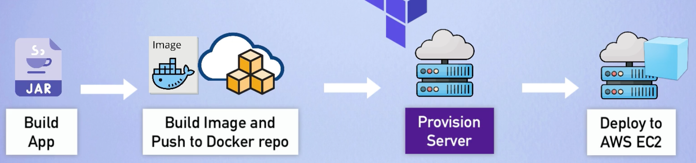
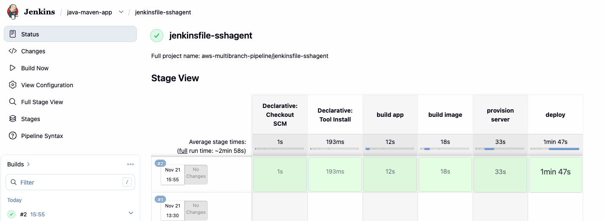
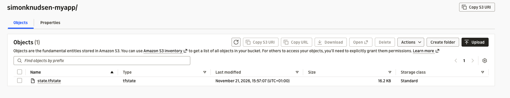
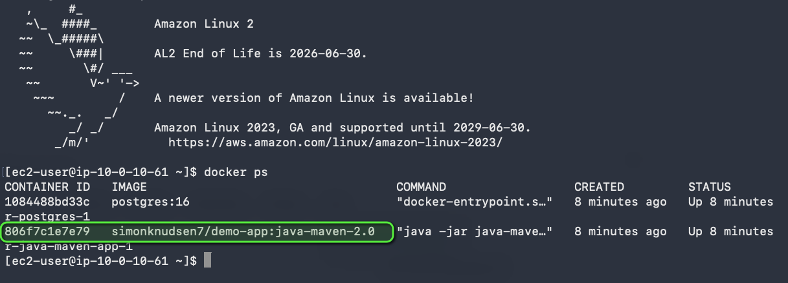

# Complete CI/CD with Terraform

## Technologies used:

Terraform, Jenkins, Docker, AWS, Git, Java, Maven, Linux, Docker Hub

## Project Description:

I added a provisioning stage to a complete CI/CD pipeline. The pipeline now creates its own server with Terraform instead of deploying to an existing one.

- **Created an SSH key pair** (`myapp-key-pair`) in AWS and stored the private key in Jenkins as the `server-ssh-key` credential, so Jenkins can connect to the new server.
- **Installed Terraform inside the Jenkins container**, so pipeline stages can run `terraform` commands.
- **Added the Terraform configuration to the application's Git repository** in the [terraform/](terraform/) folder. It creates a VPC, subnet, internet gateway, route table, security group and an EC2 instance. On first boot, [entry-script.sh](terraform/entry-script.sh) installs Docker and Docker Compose on the server. The Terraform state is stored remotely in an S3 bucket.
- **Updated the [Jenkinsfile](Jenkinsfile)** with a `provision server` stage that provisions the EC2 instance and passes its public IP to the deploy stage.
- **The complete pipeline has these steps:**
  1. **CI step:** Build the Java Maven application into a JAR file.
  2. **CI step:** Build the Docker image and push it to Docker Hub (`simonknudsen7/demo-app:java-maven-2.0`).
  3. **CD step:** Provision the EC2 instance automatically with Terraform.
  4. **CD step:** Deploy the new application version to the EC2 instance with Docker Compose. Jenkins copies [docker-compose.yaml](docker-compose.yaml) and [server-cmds.sh](server-cmds.sh) to the server over SSH, logs in to Docker Hub and starts the containers.

The pipeline steps use functions from my Jenkins shared library: `buildJar`, `buildImage`, `dockerLogin` and `dockerPush`.

## Screenshots

_Pipeline overview: build the app, build and push the Docker image, provision the server with Terraform, deploy to AWS EC2._

_The Jenkins multibranch pipeline completed all stages: build app, build image, provision server and deploy._

_Jenkins runs `terraform init` with the S3 backend, then `terraform apply --auto-approve`._

_Terraform created the EC2 instance `test-server` (t3.micro) in eu-central-1a._

_The Terraform state file (`state.tfstate`) stored in the S3 bucket._

_`docker ps` on the EC2 server shows the application container (`simonknudsen7/demo-app:java-maven-2.0`) and the Postgres container running._
